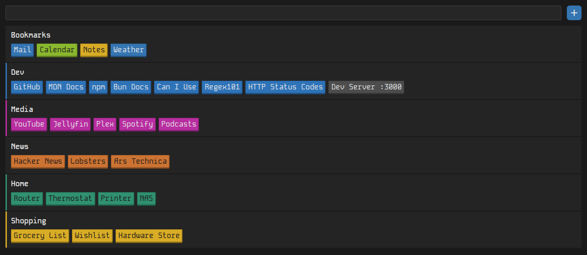
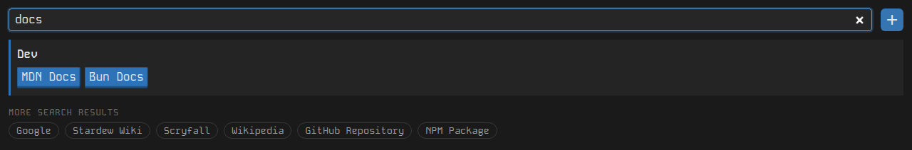
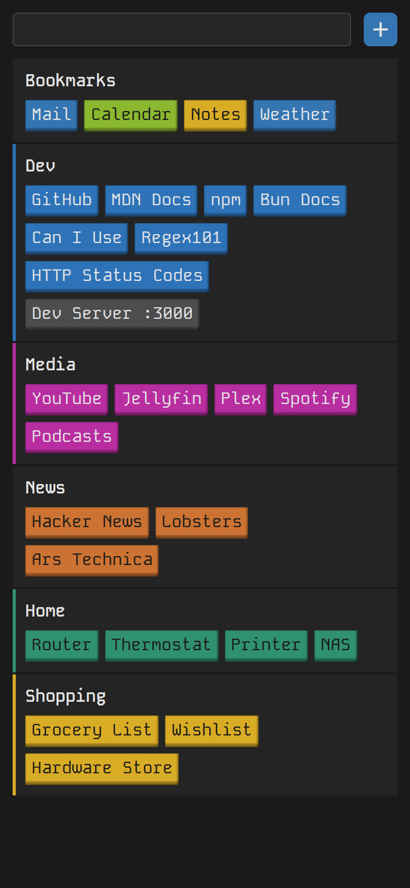

# home-page

A bookmark management web application with fuzzy search and configurable search engine integrations.



Typing filters the bookmarks at once and offers the configured search engines as chips below them:





## Setup

Requires [Bun](https://bun.sh/).

```sh
bun install
```

`bun install` also sets up the git hooks and builds the client.

## Run

```sh
# Production
bun start

# Development (hot reload)
bun run dev
```

In development the server rebuilds the client when its files change and reloads open pages. Type `b` (or `build`) in its terminal to rebuild by hand, or `stop` to end it.

## Run as a service

`bun run service:enable` installs home-page as a background service on port 8033 that starts at login and restarts if it exits (a systemd user unit on Linux, a launchd agent on macOS), through the library's `vbc-service`. `bun run deploy` rebuilds the client and restarts it. The rest: `service:disable`, `service:start`, `service:stop`, `service:reload`, `service:status`, `service:logs`.

On macOS, an install from before this used the label `com.justfatlard.home-page`: unload it (`launchctl unload ~/Library/LaunchAgents/com.justfatlard.home-page.plist`) before enabling. The Linux unit keeps its name, `home-page.service`.

## CLI Options

| Flag         | Alias | Default            | Description                    |
| ------------ | ----- | ------------------ | ------------------------------ |
| `--database` | `-d`  | `~/.homePage.json` | Path to the JSON database file |
| `--port`     | `-p`  | `8033`             | Server port                    |

## Build

```sh
bun run build          # One-off production build (vbc-build, into client/build)
```

## Test

```sh
bun test
```

## Architecture

```
server/
  index.js              Entry point — CLI args, database init, seed, server start (the library's serve, handleExit, devConsole)
  database/
    database.js         The JSON file (the library's openDatabase) and its favicons folder
    bookmarks.js        Bookmark store (createStore; inline category creation, refuses non-http(s) schemes)
    categories.js       Category store (afterDelete: cascade to bookmarks)
    searchEngines.js    Search engine store
  router/
    router.js           Main request router — entity routers, search, brand color, favicon preview, then serveApp
    bookmarks.js        /bookmarks CRUD (crudRoutes) and favicon upload
    categories.js       /categories CRUD endpoints
    searchEngines.js    /search/engines CRUD endpoints
  utils/
    search.js           Search provider execution — fetches external APIs per engine config
    defaultEngines.js   Seed data for search engines (Google, Stardew Wiki, Scryfall, Wikipedia, GitHub, npm)
    brandColor.js       A site's brand color, offered as a swatch in the bookmark dialog
    faviconColor.js     A site's favicon and its color, for the bookmark dialog's preview
    faviconStorage.js   Favicon files, kept in a `<database name>-favicons` folder beside the database
    repairFavicons.js   Re-fetches, relabels or clears favicons a browser can't draw

scripts/
  fetch-favicons.js     Runs repairFavicons over every bookmark (HOME_PAGE_DB overrides the database path)

client/
  index.js              Entry — keystroke buffering before hydration, page mount
  context.js            Shared state (pre-render search buffer)
  router.js             SPA router
  api/                  hypertether resources, invalidating each other's caches
  Bookmarks/            Main view — bookmark display, search, context menus, dialogs
```

## API

Endpoints accept and return JSON, except `GET /bookmarks/:id/favicon`, which returns the image bytes.

| Method   | Path                      | Description                                             |
| -------- | ------------------------- | ------------------------------------------------------- |
| `GET`    | `/bookmarks`              | List all bookmarks                                      |
| `POST`   | `/bookmarks`              | Create bookmark                                         |
| `GET`    | `/bookmarks/:id`          | Get bookmark                                            |
| `PATCH`  | `/bookmarks/:id`          | Update bookmark                                         |
| `DELETE` | `/bookmarks/:id`          | Delete bookmark                                         |
| `GET`    | `/bookmarks/:id/favicon`  | The bookmark's stored favicon                           |
| `PUT`    | `/bookmarks/:id/favicon`  | Store a favicon (body: `{ dataUri }`, a base64 image)   |
| `DELETE` | `/bookmarks/:id/favicon`  | Remove the stored favicon                               |
| `GET`    | `/categories`             | List all categories                                     |
| `POST`   | `/categories`             | Create category                                         |
| `GET`    | `/categories/:id`         | Get category                                            |
| `PATCH`  | `/categories/:id`         | Update category                                         |
| `DELETE` | `/categories/:id`         | Delete category (query: `moveTo` to reassign bookmarks) |
| `GET`    | `/search/engines`         | List search engines                                     |
| `POST`   | `/search/engines`         | Create search engine                                    |
| `GET`    | `/search/engines/:id`     | Get search engine                                       |
| `PATCH`  | `/search/engines/:id`     | Update search engine                                    |
| `DELETE` | `/search/engines/:id`     | Delete search engine                                    |
| `GET`    | `/search/:provider/:term` | Execute search with a configured engine                 |
| `GET`    | `/brand-color`            | A site's theme color (query: `url`)                     |
| `GET`    | `/favicon-preview`        | A site's favicon and its color (query: `url`)           |

### Bookmark creation with inline category

POST `/bookmarks` accepts `{ category: { create: { name: "New" } } }` to create a category inline during bookmark creation.

## Lint & Format

```sh
bun run lint
bun run format
```
